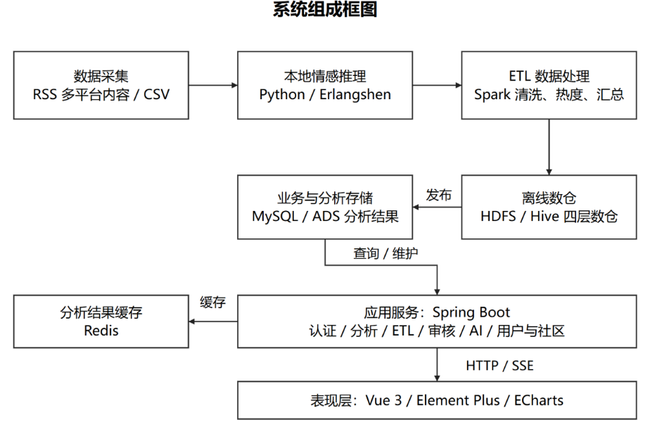
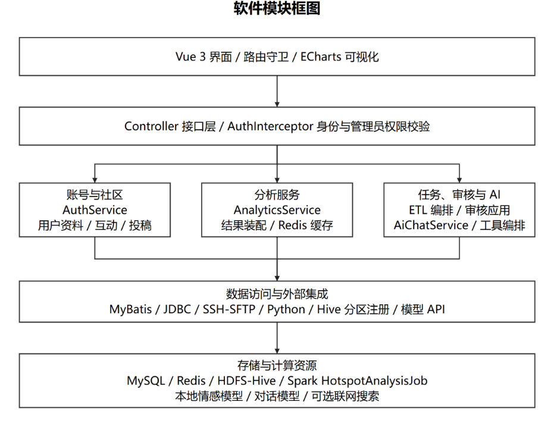
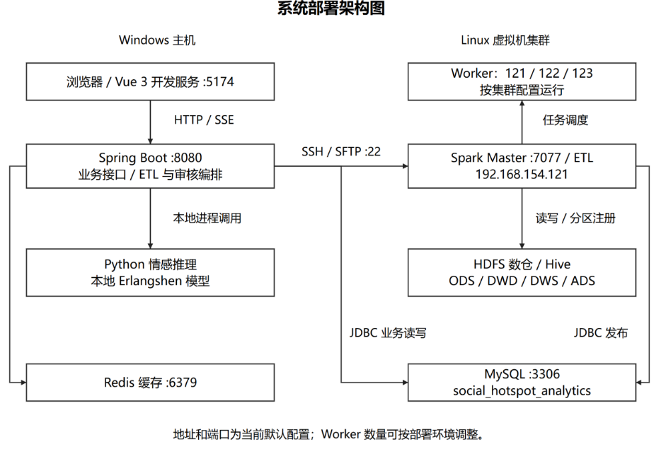
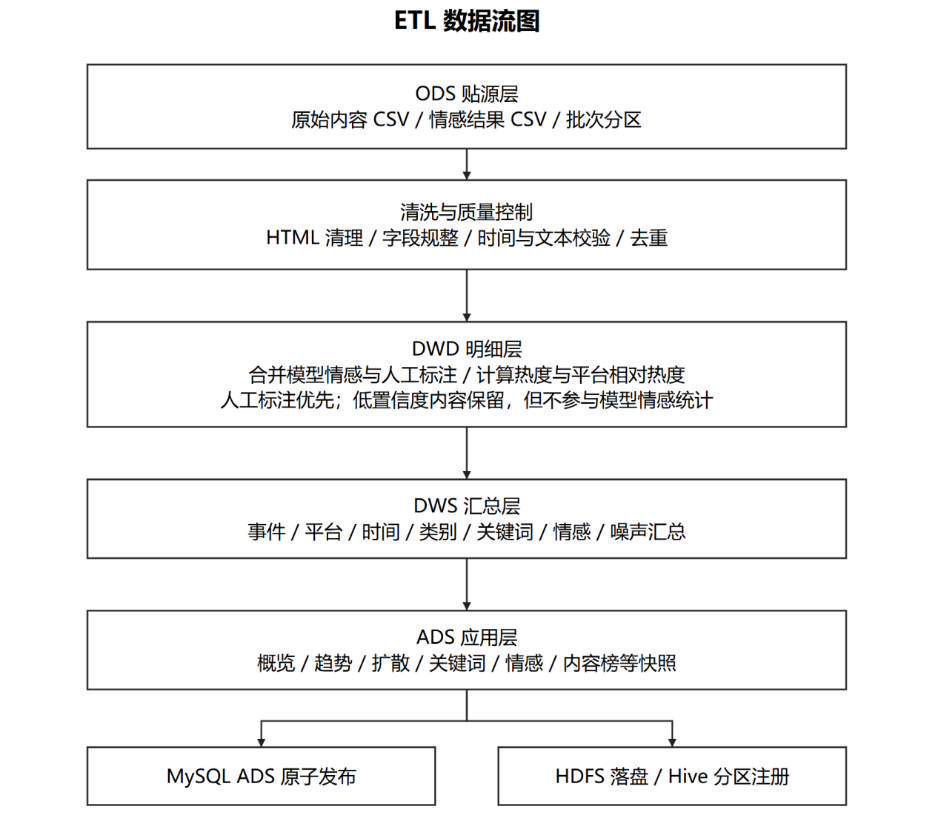
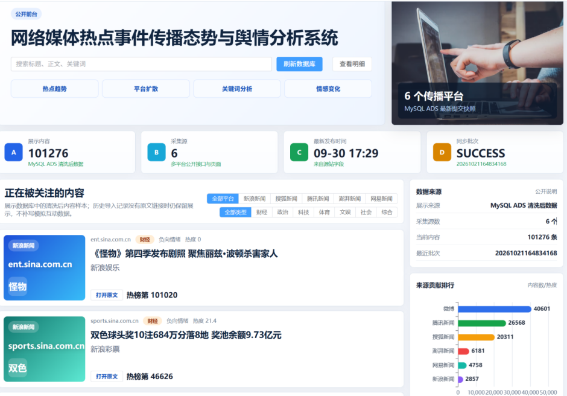
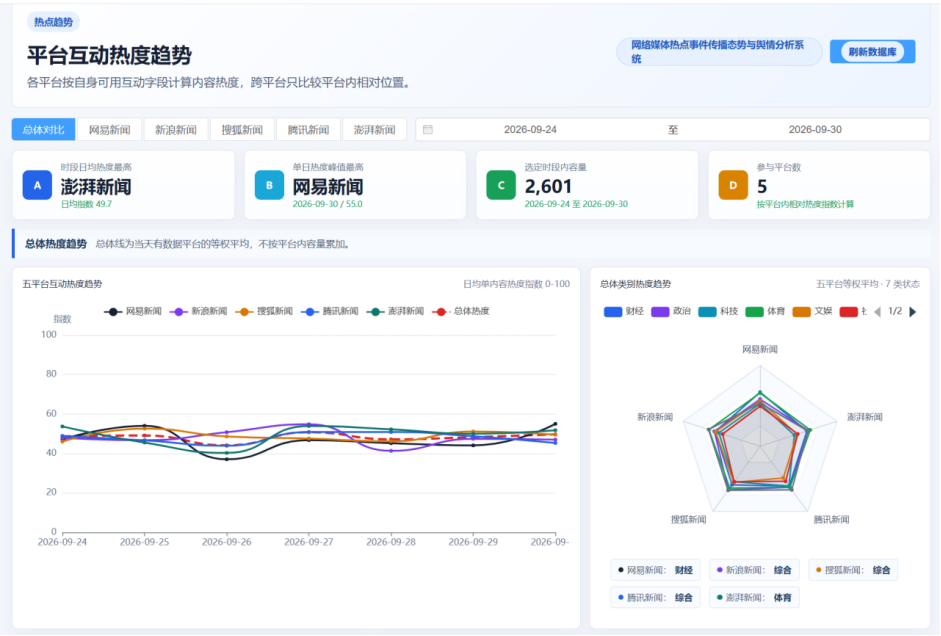
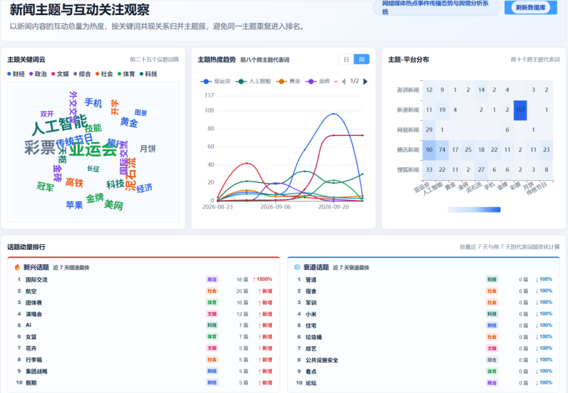
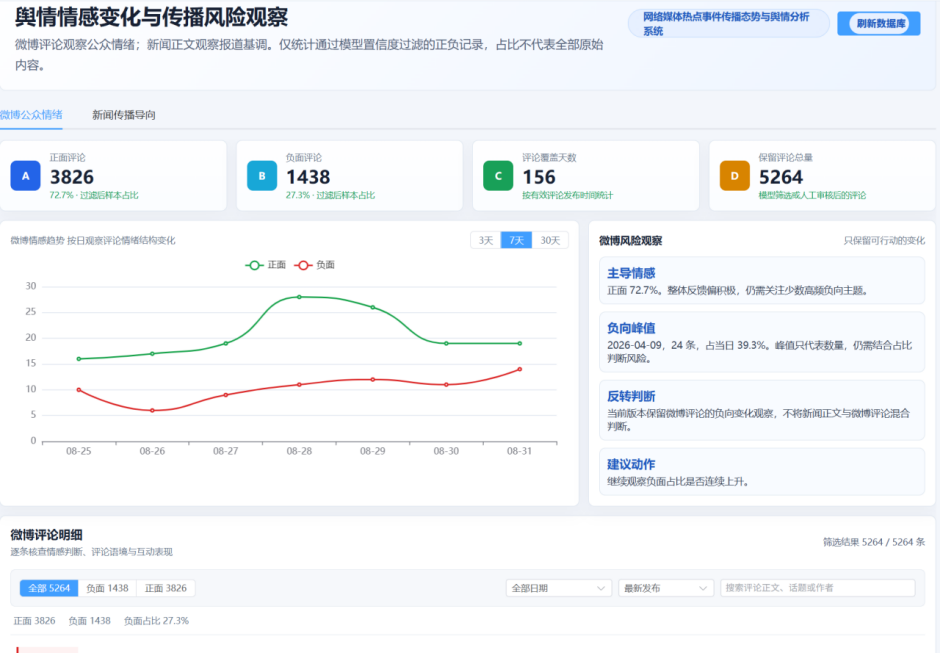
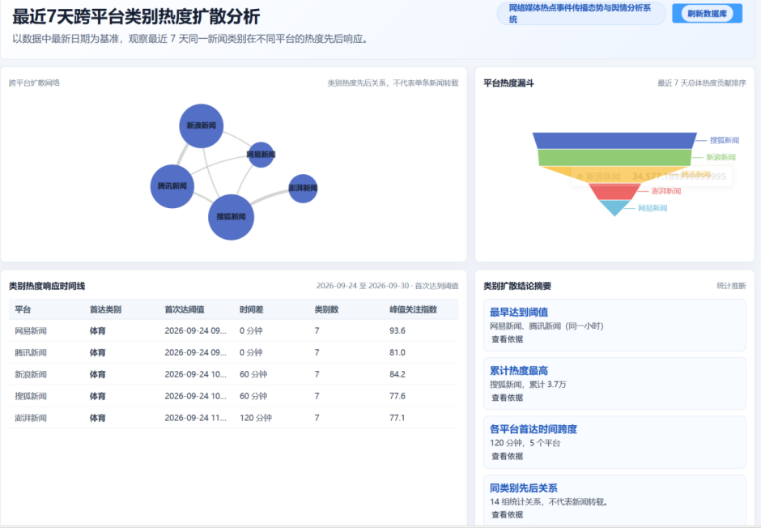
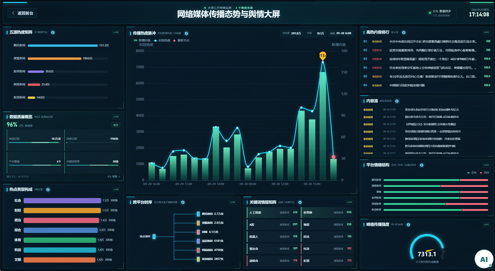

# 网络媒体热点事件传播态势与舆情分析系统

## 项目简介

网络媒体热点事件传播态势与舆情分析系统，面向热点事件的传播观察与舆情分析场景，围绕来自不同网络媒体平台的内容数据，提供从数据处理、指标分析到图表展示的一体化能力。系统将分散的内容信息整理为可查询、可比较的分析结果，帮助使用者了解事件热度变化、平台传播表现、关键词主题和公众情感倾向。

系统采用前后端分离与离线批处理相结合的方式：Web 前端负责交互和可视化，后端提供业务接口与数据服务，Python 文本处理和 Spark 分布式计算负责数据分析，处理结果存入数据库及数据仓库，供各分析页面读取。

## 建设目标

- 汇总并规范多平台网络媒体内容，形成适合统计分析的数据基础。
- 从时间、平台、关键词和情感等角度观察热点事件，辅助识别传播变化与阶段特征。
- 通过直观的图表和大屏集中呈现分析结果，降低查阅和比较数据的成本。
- 提供数据管理、任务管理与质量复核能力，支持分析数据的持续维护。

## 主要功能

- **热点总览**：以概览形式呈现事件数据规模、热度指标和主要分析信息，为进一步分析提供入口。
- **热点趋势分析**：按时间展示事件热度变化，帮助观察热度上升、回落及阶段性波动，并结合相关内容了解趋势背景。
- **平台传播分析**：从媒体平台维度比较内容分布与传播表现，辅助了解不同平台在事件传播中的表现差异。
- **关键词分析**：统计和展示内容中的关键词及主题特征，为识别事件讨论焦点提供参考。
- **情感分析**：对文本内容进行情感识别与统计，呈现不同情感倾向的分布情况，辅助观察舆情态势。
- **传播节奏分析**：从时间过程观察事件传播节奏，了解传播活动的集中时段及变化情况。
- **内容明细**：提供分析内容的查询与查看入口，便于结合具体文本理解统计指标。
- **可视化大屏**：集中展示事件传播和舆情分析的关键指标，适用于整体态势浏览与展示。
- **数据管理与质量复核**：围绕数据处理任务和待核验记录提供管理能力，帮助维护数据质量。

## 数据处理与分析

系统的数据处理流程从原始内容数据开始。进入分析流程后，数据经过字段规范化、文本质量处理和必要的清洗，再结合情感分析结果生成可用于统计的记录。对于需要进一步确认的数据，可由质量复核流程辅助检查和修正。

Spark ETL 负责批量处理内容数据、关联分析结果并计算面向页面展示的统计指标。处理后的明细和汇总结果按数据层次组织，并写入数据仓库及分析数据库。后端服务根据页面请求读取相应结果，前端再以趋势图、分布图、排名和综合指标等形式呈现。

这样的处理方式将较重的数据计算与页面查询分开：离线任务负责批量清洗和聚合，Web 服务负责业务访问和结果组织，使分析页面能够围绕已生成的数据集进行查询与展示。

## 系统架构

系统主要由以下部分协同组成：

- **可视化前端**：基于 Vue 构建分析、管理和大屏页面，使用图表组件呈现统计结果。
- **业务后端**：基于 Spring Boot 提供分析查询、用户与数据管理、任务管理及相关业务接口。
- **文本分析组件**：使用 Python 与本地情感模型处理文本，提供情感预测及数据质量相关处理能力。
- **离线计算组件**：使用 Apache Spark 执行批量清洗、数据关联、指标计算和结果整理。
- **数据存储组件**：使用 MySQL 保存应用和分析数据，并结合 Redis、HDFS 与 Hive 支持缓存、批次数据和仓库数据管理。

系统模块组成、部署关系与 ETL 数据流如下：

| 系统组成框图 | 软件模块框图 |
| --- | --- |
|  |  |

| 系统部署架构图 | ETL 数据流图 |
| --- | --- |
|  |  |

## 系统界面

下图展示了系统首页及主要分析页面。页面围绕事件概览、热度趋势、关键词、情感和传播节奏组织，另提供综合可视化大屏。

| 系统首页 | 热点趋势分析 |
| --- | --- |
|  |  |

| 关键词分析 | 情感分析 |
| --- | --- |
|  |  |

| 传播节奏分析 | 可视化大屏 |
| --- | --- |
|  |  |

## 技术组成

分析模块已按页面拆分为独立的 Controller、Service、ServiceImpl、Mapper 和 SQL 映射，文件入口见 [分析模块代码导航](server/backend/分析模块代码导航.md)。

系统使用单账号登录，不提供注册、角色权限和用户管理。已有数据库升级步骤见 [单账号迁移说明](deploy/sql/migrations/README.md)。分析接口统一为 `/api/analysis/...`，数据集由后端确定。

- **前端**：Vue 3、TypeScript、Vite、Element Plus、ECharts，用于页面开发、组件交互和数据可视化。
- **后端**：Java、Spring Boot、MyBatis，用于构建业务接口和数据库访问服务。
- **离线计算**：Apache Spark SQL，用于批量数据清洗、关联与聚合分析。
- **文本处理**：Python、Pandas、PyTorch、Transformers，用于文本质量处理和情感推理。
- **存储与数据仓库**：MySQL、Redis、HDFS、Hive，分别支持业务/分析数据、缓存和分布式仓库数据管理。
